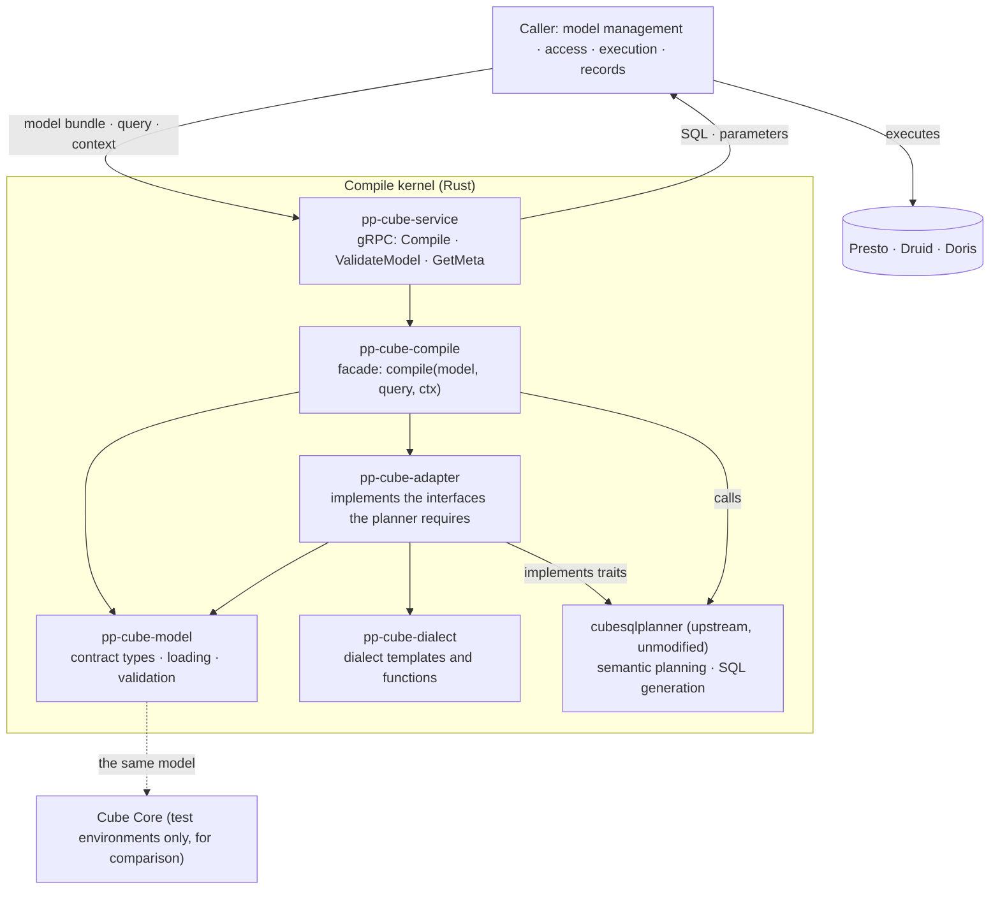

# Engine kernel design

Continuation of [Engine design](engine-design.md), public edition v0.4. Section numbering follows the source design.

## 5 Overall design of the kernel

### 5.1 Structure



### 5.2 Two principles

- **Upstream code is not changed.** `cubesqlplanner` comes in as a git submodule pinned to a commit; this project's code lives in the adapter layer and above. A needed change is first attempted in the adapter; when upstream really must change, the change is submitted upstream, and no local patch is kept.
- **The kernel is a pure function.** No IO, no credentials, no session state. The same model bundle, query and context give the same result.

### 5.3 Workspace

```text
pp-cube-engine/
├── vendor/cube/                 upstream repository (git submodule, pinned, read-only)
├── crates/
│   ├── pp-cube-model            contract types, YAML/JSON loading, baseline validation
│   ├── pp-cube-adapter          implements cubesqlplanner's bridge interfaces
│   ├── pp-cube-dialect          templates and functions for presto · doris · druid
│   ├── pp-cube-compile          the facade and the per-thread context cache
│   ├── pp-cube-service          the gRPC service and process entry point
│   └── pp-cube-conformance      conformance tests: comparison with Cube Core
├── templates/                   dialect templates (data files)
└── Cargo.toml                   carries the same [patch] section as upstream
```

The upstream workspace uses its own fork of `chrono-tz`. This workspace's `Cargo.toml` carries the same `[patch]` section and follows the dependency versions in upstream's `Cargo.lock`.

## 6 Design of each crate

### 6.1 `pp-cube-model`: contract and validation

- Contract types are plain data structures, shareable across threads and serialisable.
- Loading: YAML or JSON → contract types. The starting point is the YAML loading code in the upstream fixtures, which reads Cube's YAML model.
- Validation has two layers:
  - **Cube validity**: required fields, allowed type values, member references resolve, join targets exist, a cube taking part in a join has a primary key, a pair of cubes has one join.
  - **Baseline constraints**: each item in 3.5; a field outside the baseline is an error that names the field.
- The validation result is a structured list of issues, each with an object path, a rule id and a message, suitable for showing in a modelling interface.

Whether `sql` is a single-table row-level query requires parsing the SQL text. `sqlparser` is used for a syntax check: exactly one `SELECT`, one table, no `GROUP BY`, `DISTINCT`, window function or join. It only judges; it does not rewrite the text.

### 6.2 `pp-cube-adapter`: implementing the bridge interfaces

The planner reaches the model through a set of traits. The adapter implements them on top of the contract types. What B0 needs:

| Interface group | Responsibility | B0 implementation |
| --- | --- | --- |
| Model access | Definitions of cubes, dimensions, measures and segments by path; the kind of a member | Reads the contract types directly |
| Member expressions | Compiles `{CUBE}.x` and `{member}` into the template and dependency list the planner wants | Parses the brace references and produces a template of the form `{arg:N}` |
| Join graph | For a set of cubes, returns the join tree and whether each cube is multiplied | Shortest path over the join graph; the baseline has only many-to-one joins, so a unique path is returned and an ambiguous one is an error |
| Dialect tools | Time truncation, time zone conversion, timestamp conversion, interval arithmetic and so on | Calls `pp-cube-dialect` |
| Template rendering | Renders a template by name | Calls `pp-cube-dialect` |
| Query options | Converts Cube query JSON into the planner's query options | Field by field |
| The rest | Pre-aggregations, `case`, geo, multi-stage calculations, security context and so on | Returns empty; model validation guarantees they are not used |

**Starting point**: copy the interface implementations from the upstream fixtures (about 10,000 lines), keeping the copyright notice and stating the origin, then do three things: replace the YAML fixture types with the contract types of `pp-cube-model`; remove construction paths that exist only for tests; change each `panic` on invalid input into a returned error.

The crate does not depend on the upstream fixtures directly because they exist only in upstream's test builds and carry no promise of stability.

### 6.3 `pp-cube-dialect`: dialects

A dialect has two parts:

- **Templates**: Jinja strings, which are data. The base set and each dialect's overrides are extracted from the JavaScript code at the pinned commit and stored as data files. The planner renders with `minijinja`; the adapter uses the same library.
- **Functions**: about twenty small functions (time truncation, time zone conversion, interval addition and subtraction, timestamp conversion and so on), implemented once per dialect in Rust, following the methods of the same name in the JavaScript code.

| Engine | Template source | B0 | B1 |
| --- | --- | --- | --- |
| Presto | Cube's PrestoDB dialect | Planned | Planned |
| Doris | Cube has no Doris dialect; start from the MySQL dialect and adjust | Planned | Verified item by item |
| Druid | Cube's Druid dialect (community maintained) | Planned | The SQL for multi-fact queries and time shifts contains `UNION ALL` inside a subquery, which Druid does not support; these queries are refused on Druid |

Each dialect declares which baseline features it supports. When a query uses a feature its dialect does not support, the kernel answers "unsupported" and does not generate SQL that might be wrong.

### 6.4 `pp-cube-compile`: the facade

Three functions face outward: compile, validate, and metadata.

```rust
/// The context of one compilation. Row-level access rules arrive as filters
/// the caller has already converted.
pub struct CompileContext {
    pub dialect: DialectId,
    pub timezone: String,
    pub security_filters: Vec<FilterItem>,
    pub request_id: String,
}

pub struct Compiled {
    pub sql: String,
    pub params: Vec<ParamValue>,
    pub columns: Vec<OutputColumn>,
    pub used_cubes: Vec<UsedCube>,
    pub fingerprint: [u8; 32],
}

#[derive(Debug)]
#[non_exhaustive]
pub enum CompileError {
    /// The model is invalid or outside the baseline.
    Model(Vec<ModelIssue>),
    /// The query names a member that does not exist, uses an operator that
    /// does not fit the type, and so on. The caller can correct it.
    Query(String),
    /// The query uses a feature the dialect or the baseline level does not support.
    Unsupported(String),
    /// An internal planner error.
    Internal(String),
}

/// Compiles one query. No IO.
pub fn compile(
    model: &ModelBundle,
    query: &CubeQuery,
    ctx: &CompileContext,
) -> Result<Compiled, CompileError> {
    let query = with_security_filters(query, &ctx.security_filters);
    with_planner_context(model, ctx, |planner| planner.plan(&query))
}

/// Validates a model bundle and returns every issue.
pub fn validate(model: &ModelBundle) -> Vec<ModelIssue> {
    check_cube_rules(model)
        .into_iter()
        .chain(check_baseline_rules(model))
        .collect()
}
```

Security filters are appended as top-level filter entries of the query, beside the user's filters. They cannot end up inside a user's "or" group, because appending happens inside the facade and the caller cannot choose the position.

### 6.5 Thread model

The planner uses `Rc` throughout and cannot cross threads. So:

- The model bundle is an `Arc<ModelBundle>` and is shared across threads.
- What the planner needs (adapter objects, compiled templates) is created per thread and cached in a thread-local variable, keyed by model bundle digest and dialect; when the bundle version changes, the old cache entry stops matching.
- Compilation runs synchronously on a fixed-size pool of worker threads. The service dispatches requests to the pool and does not call the planner on the async runtime's threads.

```rust
thread_local! {
    /// Each worker thread's own planner context, keyed by bundle digest and dialect.
    static PLANNER: RefCell<Option<(ContextKey, Rc<PlannerContext>)>> = const { RefCell::new(None) };
}

fn with_planner_context<T>(
    model: &ModelBundle,
    ctx: &CompileContext,
    f: impl FnOnce(&PlannerContext) -> Result<T, CompileError>,
) -> Result<T, CompileError> {
    let key = ContextKey::new(model, ctx.dialect);
    PLANNER.with(|slot| {
        let mut slot = slot.borrow_mut();
        let reuse = matches!(slot.as_ref(), Some((cached, _)) if *cached == key);
        if !reuse {
            *slot = Some((key, Rc::new(PlannerContext::build(model, ctx)?)));
        }
        match slot.as_ref() {
            Some((_, planner)) => f(planner),
            None => Err(CompileError::Internal("planner context missing".into())),
        }
    })
}
```

### 6.6 Error model

The planner's errors are of two kinds, user errors and internal errors. The facade maps them onto the four errors of 6.4. A message returned to the caller contains member names and rules only, not physical table structure.

### 6.7 Determinism

- The six tested queries gave identical output across process runs, but the planner uses hash containers and gives no structural guarantee.
- The safeguard: a golden case for each kind of baseline query, compiled in CI by several separate processes and compared; a difference is traced into upstream and a fix submitted there.
- `fingerprint` includes the kernel version and the pinned upstream commit, for plan caching and for tracing problems.

### 6.8 `pp-cube-service`: the service

The listing below is the original draft. The implemented contract is
`crates/pp-cube-service/proto/engine.proto`: it adds typed parameters, structured
used cubes, session properties, a failure-kind enum, a response identity and
typed metadata.

```proto
syntax = "proto3";

package ppcube.engine.v1;

service CubeEngine {
  // Compiles one query into SQL and parameters. Does not execute.
  rpc Compile(CompileRequest) returns (CompileResponse);
  // Validates a model bundle and returns every issue. Called before publishing.
  rpc ValidateModel(ValidateModelRequest) returns (ValidateModelResponse);
  // Returns the public cubes, measures and dimensions of a model bundle.
  rpc GetMeta(GetMetaRequest) returns (GetMetaResponse);
}

message CompileRequest {
  string model_version = 1;   // a loaded model bundle version
  string query_json = 2;      // Cube query format
  string dialect = 3;         // presto | doris | druid
  string timezone = 4;
  repeated string security_filters_json = 5;  // Cube filter format; each is appended as a top-level filter
  string request_id = 6;
}

message CompileResponse {
  oneof result {
    Compiled compiled = 1;
    CompileFailure failure = 2;
  }
}

message Compiled {
  string sql = 1;
  repeated string params = 2;
  repeated OutputColumn columns = 3;
  repeated string used_tables = 4;
  bytes fingerprint = 5;
}

message OutputColumn {
  string alias = 1;
  string member = 2;
  string type = 3;
}

message CompileFailure {
  string kind = 1;     // model | query | unsupported | internal
  string message = 2;
}

message ValidateModelRequest { bytes model_bundle = 1; }
message ValidateModelResponse { repeated ModelIssue issues = 1; }
message ModelIssue {
  string path = 1;     // for example cubes.sales.measures.amount
  string rule = 2;
  string message = 3;
}
message GetMetaRequest { string model_version = 1; }
message GetMetaResponse { string meta_json = 1; }
```

The service loads model bundles by version. A bundle is validated when loaded and does not take effect if validation fails. The service is stateless and can run as several instances.

### 6.9 Upgrading upstream

- One commit is pinned. An upgrade is a deliberate act, considered once a quarter or when a particular fix is needed.
- Steps: move the submodule → compile the adapter (interface changes show up here) → extract the dialect templates again → run the golden cases and the conformance tests → review every SQL difference.
- The upstream directory had 52 commits in the 30 days before the pin, and its interfaces carry no promise of stability. The cost of an upgrade has to be measured on the first one.

## 7 Caller and kernel

| Activity | Caller | Kernel |
| --- | --- | --- |
| Editing, storing and publishing models | Does it | — |
| Model validation | Calls `ValidateModel` and shows the issues | Validates |
| Structured request → Cube query | Does it: name resolution, relative periods to absolute dates | — |
| Access decision → row-level filters | Does it | Appends the filters as top-level conditions |
| Compilation | Calls `Compile` | Does it |
| Executing SQL | Executes the returned SQL and parameters without rewriting them | — |
| Result handling, output control, records | Does it | Supplies column information, the tables used and the fingerprint |
| Features that need several queries, such as `compareDateRange` | Splits them into several compilations and merges the results | — |

Dependencies point one way: the caller calls the kernel.

## 8 Baseline acceptance

| Layer | Method | Passes when |
| --- | --- | --- |
| Golden cases | "Model + query → SQL" stored per dialect; a change needs human review | No unexpected difference |
| Determinism | The same case compiled once each by several processes | Output is byte-identical |
| Comparison with Cube Core | The same model and query given to Cube Core at the pinned version (`/v1/sql`); both SQL statements run on the same data | Results are equal value by value |
| Real engines | SQL generated for the three dialects runs on Presto, Doris and Druid | It runs, and results equal those of hand-written SQL |
| Validator | For each baseline constraint, a model built to break it | Every one is rejected, with the issue located at the field |
| Access filters | A user filter with an "or" group plus security filters | The security conditions are always at the top-level "and" position |

Cube Core runs only in test environments for the comparison. Cube Core has no Doris dialect; for Doris the comparison is with hand-written SQL instead.

B0 acceptance covers every feature marked B0 in 3.7 on Presto and Doris, and single-cube queries on Druid.

## Appendix A: measured output

The SQL below was generated by the planner at the pinned commit with the upstream fixtures' default templates, so it is PostgreSQL style. It was measured against a private demonstration model. In this edition the table, column and member names have been replaced with neutral ones; the structure of each statement is unchanged.

The model as named here: `sales` (sales detail, `sql_table: dw.sales_dtl`), `refunds` (refund detail) and `dim_store` (store dimension table). Each fact cube has one `many_to_one` join to `dim_store`.

**Q1. Single cube: sum, distinct count, filtered measure, ratio, with filters and a time range**

```sql
SELECT "sales".channel_cd "sales__channel_cd",
       sum("sales".amount) "sales__amount",
       COUNT(DISTINCT "sales".order_no) "sales__order_count",
       sum(CASE WHEN ("sales".category_cd = 'TOY') THEN "sales".amount END) "sales__toy_amount",
       sum("sales".amount) / NULLIF(COUNT(DISTINCT "sales".order_no), 0) "sales__amount_per_order"
FROM dw.sales_dtl AS "sales"
WHERE ("sales".sold_at >= $1::timestamptz AND "sales".sold_at <= $2::timestamptz)
  AND ("sales".is_valid = $3)
  AND ("sales".channel_cd IN ($4, $5))
GROUP BY 1
ORDER BY 1 ASC
LIMIT 1001
```

Parameters: `2026-10-01T00:00:00.000`, `2026-10-31T23:59:59.999`, `1`, `C1`, `C2`.

**Q2. Many-to-one join: a dimension from the store table, grouped by month**

```sql
SELECT "dim_store".region_cd "dim_store__region_cd",
       date_trunc('month', ("sales".sold_at::timestamptz AT TIME ZONE 'UTC')) "sales__sold_at_month",
       sum("sales".amount) "sales__amount"
FROM dw.sales_dtl AS "sales"
LEFT JOIN dw.dim_store AS "dim_store" ON "sales".store_cd = "dim_store".store_cd
WHERE ("sales".sold_at >= $1::timestamptz AND "sales".sold_at <= $2::timestamptz)
  AND ("dim_store".region_cd IN ($3, $4))
GROUP BY 1, 2
ORDER BY 2 ASC
```

**Q6. An "or" group beside other top-level filters**

```sql
SELECT sum("sales".amount) "sales__amount"
FROM dw.sales_dtl AS "sales"
WHERE ("sales".is_valid = $1)
  AND (("sales".channel_cd = $2) OR ("sales".category_cd = $3))
```

**The shape of B1 queries** (Q3 multi-fact, Q4 month to date, Q5 same period last year):

- Q3: one common table expression per fact, each joined and aggregated to the shared dimensions; then the dimension keys of all the expressions are combined with `UNION ALL` and de-duplicated into a key set, and each expression is `LEFT JOIN`ed back, with a join condition that treats nulls as equal.
- Q4: a daily time series is generated first, then range-joined to the daily aggregate and summed.
- Q5: the same period last year is the same aggregate with one year added to the time column, as a common table expression, combined with the current period the way Q3 combines facts.

All three contain `UNION ALL` inside a subquery or the generation of a time series, which is why B1 is limited on Druid.
